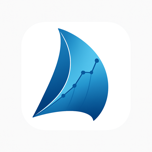

# Expedition Marine Channel Requirements

  

  <strong>Tx Filter and Logging Channels Required by SailWatchPro</strong>

---

## Table of Contents

- [Overview](#overview)
- [Two Lists in Expedition](#two-lists-in-expedition)
- [How to Enable Channels in the Tx Filter](#how-to-enable-channels-in-the-tx-filter)
- [How to Enable Channels for Logging](#how-to-enable-channels-for-logging)
- [Channels SailWatchPro Uses](#channels-sailwatchpro-uses)
- [Also Tick for Logging](#also-tick-for-logging)
- [Commonly Missing from Logs](#commonly-missing-from-logs)
- [Channels That Depend on Your Equipment](#channels-that-depend-on-your-equipment)
- [What a Log Looks Like When It Is Right](#what-a-log-looks-like-when-it-is-right)
- [Channel Health Monitor](#channel-health-monitor)
- [What to Do If a Channel Goes Silent](#what-to-do-if-a-channel-goes-silent)

---

## Overview

SailWatchPro gets Expedition Marine's numbers two ways:

- **Live, over the boat network.** The iOS app reads Expedition's UDP broadcast. This is what drives sail crossover, layline guidance, start sequencing, weather and the course display on the water.
- **Afterwards, from the log file.** The web portal at [sailwatchpro.com](https://sailwatchpro.com) analyzes uploaded `.csv` logs, and the iOS app can replay a log as if the boat were sailing.

Each has its own list of channels in Expedition, and a channel has to be ticked in both to appear in both.

---

## Two Lists in Expedition

| List | Where | Controls |
|:-|:-|:-|
| **Exp Tx filter** | The network connection's settings | What Expedition broadcasts to the iOS app |
| **Logging** | **All Settings ▸ Logging** | What Expedition writes to the `.csv` log |

The two are independent. Ticking a channel in the Tx filter does not put it in the log. A boat can have every start number on the iPad during a race and find the same numbers missing when the race is replayed or analyzed, because they were never ticked under Logging.

The simplest rule: **tick the same channels in both lists**, then add the few log-only channels below.

---

## How to Enable Channels in the Tx Filter

Step 1 of the [Setup Guide](SETUP-GUIDE.md#step-1--find-ip-addresses) walks through opening the Tx filter dialog. Once you are in **Exp Tx filter**, tick every channel in [Channels SailWatchPro Uses](#channels-sailwatchpro-uses). The dialog is alphabetical; the tables here are also alphabetical, so you can scan top-to-bottom in both at the same time.

When you are done, click **OK**, and verify in SailWatchPro that the connection indicator turns green.

---

## How to Enable Channels for Logging

1. In Expedition, open the menu button (☰) at the top left of the window and choose **All Settings**.
2. Choose **Logging** in the list on the left.
3. Make sure **Log data** is ticked.
4. Tick every channel in [Channels SailWatchPro Uses](#channels-sailwatchpro-uses) and in [Also Tick for Logging](#also-tick-for-logging). This list is alphabetical too.
5. Click **OK**.

The change applies to logs written from then on. Logs already recorded cannot be filled in afterwards.

---

## Channels SailWatchPro Uses

These are the channels the iOS app actively consumes — derived from the field mapping in `ExpeditionDataManager.swift` (`merged()`) plus the four sail-name channels handled by `handleSailUpdate(...)`. Tick them in the **Exp Tx filter** and under **All Settings ▸ Logging**. If any of these stop arriving over the network, [Channel Health Monitor](#channel-health-monitor) in the app will flag them.

Some need equipment your boat may not have; see [Channels That Depend on Your Equipment](#channels-that-depend-on-your-equipment).

<!-- Channel lists maintained in reflow_table.py — add new IDs there and run the script to regenerate these tables. The script's iOS list mirrors ExpeditionDataManager.swift; keep them in sync. -->

| | | |
|:-|:-:|:-:|
| Air temperature | AWA | AWS |
| Barometer | BSP | Cog |
| Current drift | Current drift predicted | Current set |
| Current set predicted | Depth | Dew point |
| Forestay load | Heading | Heading to steer |
| Heading to steer polar | Heel (roll) | Latitude |
| Layline bearing | Layline bearing on port | Layline bearing on strb |
| Layline dist on port | Layline dist on starb | Layline distance |
| Layline time | Layline time GPS | Layline time on port |
| Layline time on starb | Longitude | Magnetic variation |
| Mark bearing | Mark bearing - Cog | Mark range |
| Mark time | Mark twa | Next mark awa |
| Next mark aws | Next mark bearing | Next mark polar time |
| Next mark twa | Opposite track Cog | Polar bsp |
| Polar bsp % | Relative humidity | Rudder |
| Sail | Sail event | Sail mark |
| Sail next mark | Sea temperature | Sog |
| Start bias angle | Start bias length | Start distance below line |
| Start layline on port | Start layline on strbd | Start line square wind |
| Start port latitude | Start port longitude | Start stbd latitude |
| Start stbd longitude | Start time to burn | Start time to gun |
| Start time to layline P | Start time to layline S | Start time to line |
| Start time to port | Start time to port burn | Start time to strb |
| Start time to strb burn | Target awa | Target bsp |
| Target bsp % | Target heel | Target twa |
| Target vmg | TWA | TWD |
| TWD predicted | TWS | TWS predicted |
| VMC | VMC % | VMC optimum |
| VMC optimum heading | VMC optimum twa | VMG |
| VMG % |  |  |

<!-- 88 channels total -->

---

## Also Tick for Logging

These are not read from the live broadcast, so they only need ticking under **All Settings ▸ Logging**.

| | | |
|:-|:-:|:-:|
| Leeway | Mark latitude | Mark longitude |
| Rate of turn | Tack/gybe loss metres | Tack/gybe loss time |

<!-- 6 channels total -->

| Channels | Why |
|:-|:-|
| Mark latitude, Mark longitude | A replay rebuilds the active mark from these. |
| Tack/gybe loss time, Tack/gybe loss metres | The web portal's race-log parser uses them for per-maneuver loss. |
| Leeway, Rate of turn | Used by the web portal's analysis. |

> **Note:** Because the iOS app does not read these from the broadcast, Channel Health Monitor on iOS will **not** warn you if they are missing.

---

## Commonly Missing from Logs

These channels are in the table above and usually ticked in the Tx filter, but they are the ones we have found absent from uploaded logs. If you check nothing else under **All Settings ▸ Logging**, check these.

| | | |
|:-|:-:|:-:|
| Heading to steer polar | Layline bearing on port | Layline bearing on strb |
| Layline dist on port | Layline dist on starb | Layline time |
| Layline time GPS | Next mark polar time | Next mark twa |
| Opposite track Cog | Polar bsp % | Start bias angle |
| Start bias length | Start time to port burn | Start time to strb burn |
| Target bsp % | VMC optimum heading | VMC optimum twa |

<!-- 18 channels total -->

Without them a replay or an analysis has no start bias, no time to burn at each end of the line, and no layline distance on each tack. The app can estimate some of these from the rest of the log, but an estimate uses the polars of the boat you are signed into, which is only right when that is the boat that made the log.

---

## Channels That Depend on Your Equipment

Tick these if your boat has the source. Expedition has nothing to send or log for a channel with no sensor behind it, and SailWatchPro simply leaves that card empty.

| Needs | Channels |
|:-|:-|
| A sail chart set up in Expedition | Sail, Sail event, Sail mark, Sail next mark |
| A GRIB loaded in Expedition | Current drift predicted, Current set predicted, TWD predicted, TWS predicted |
| Depth sounder | Depth |
| Rudder sensor | Rudder |
| Mast load cell | Forestay load |
| Air, sea and pressure sensors | Air temperature, Barometer, Sea temperature |
| Humidity sensor | Dew point, Relative humidity |
| Motion sensor (logging only, for the web portal) | Heave, Wave max height, Wave max period, Wave sig height, Wave sig period |

---

## What a Log Looks Like When It Is Right

A few things in a correct log look like faults and are not:

- **The start line appears on only a few rows.** Expedition writes the line ends when an end is pinged, not continuously. SailWatchPro carries them through the rest of the log.
- **A day with no start line.** If nobody pinged a line in Expedition that day, the log has none.
- **The active mark appears only when it changes**, for the same reason.
- **Mark names and the course are not in the log.** Expedition logs the active mark's position only, so a replay shows marks as "Mark 1", "Mark 2" in the order the boat reached them.

---

## Channel Health Monitor

Once your boat has been broadcasting for a while, SailWatchPro learns which channels you typically send. From then on, **Settings → Channel Health → Run Check Now** compares the channels arriving right now against that historical set and flags any that have stopped.

Learning is per-boat: switching boats in **Boat Configuration** swaps the monitor to that boat's bucket, so a boat without (for example) a barometer will not be warned about it.

Channel Health watches the live broadcast only. It cannot tell you what is being written to the log; for that, check **All Settings ▸ Logging** in Expedition.

This is a setup and verification tool — useful when:

- Setting up SailWatchPro on a new boat
- Verifying the data feed after restarting Expedition
- Troubleshooting an iOS display that does not look right

---

## What to Do If a Channel Goes Silent

1. Confirm the channel is still ticked in Expedition's **Exp Tx filter**. Channels can get unticked accidentally when reviewing the dialog.
2. Confirm Expedition is still running and connected to the boat's instrument network.
3. If the channel is sourced from a sensor (e.g. depth, barometer, heel), verify the sensor itself is reporting through the NMEA 2000 / instrument network into Expedition.
4. Restart Expedition's network connection (see [Step 1 of the Setup Guide](SETUP-GUIDE.md#step-1--find-ip-addresses)).
5. If the issue persists, see the [Troubleshooting Guide](TROUBLESHOOTING.md).

If a number is on the iPad during a race but missing from a replay or from the web portal's analysis, the channel is being broadcast and not logged: tick it under **All Settings ▸ Logging**.
