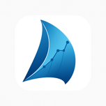

# SailWatchPro

  
    
  <strong>Race from your boat's instruments, on iPad, iPhone and Apple Watch.</strong>

SailWatchPro is a sailboat racing app. It reads the boat's instruments, from Expedition Marine, an NMEA 2000 gateway, a B&G display network or the iPad's own GPS, and puts on deck what the crew needs: live dashboards, the start, the course and the next rounding, competitors, wind and weather, sails, and advisories that watch the conditions so nobody has to. After the race, the web app at [sailwatchpro.com](https://sailwatchpro.com) holds the logbook, the analysis and the program's planning.

Expedition Marine is optional. A boat with no PC aboard runs SailWatchPro from an NMEA 2000 gateway, a B&G display network or the iPad's own GPS; a boat with Expedition gets the integration with it on top.

The boat is set up once on the web and imported to each device. The app is free; a plan unlocks its paid half: advisories after the gun, the chart map with routing, currents and depths, competitors, and the instrument log with post-race analysis.

This repository holds the public documentation. The app itself is distributed through TestFlight while in beta.

---

## Documentation

| Document | What it covers |
|----------|----------------|
| [Setup Guide](SETUP-GUIDE.md) | Network, Expedition Marine, your account and boat on the web, data sources, installing the app and Import Setup. Start here. |
| [User Manual](USER-MANUAL.md) | What each screen does, a lookup table for every Settings section, and the Apple Watch. |
| [Subscription & Licensing Guide](SUBSCRIPTION-AND-LICENSING.md) | The plans, how a plan reaches the boat's devices and crew, renewals, cancelling, the beta program. |
| [Troubleshooting Guide](TROUBLESHOOTING.md) | Red status indicators, nothing arriving from Expedition or the gateway, firewalls, Parallels. |
| [Advisory Reference](ADVISORY-REFERENCE.md) | Every advisory: what triggers it, its thresholds and its wording. |
| [Expedition Channels](EXPEDITION-CHANNELS.md) | The Expedition Marine channels to enable for the app and for the web app's log analysis. |
| [Weather Intelligence Reference](WEATHER-INTELLIGENCE.md) | Technical notes on the forecast monitoring behind the wind and weather screens. |

The `documents/` folder has sample files in the formats the web app imports: an Expedition polar, a sailmaker's crossover chart in Expedition's `.txt` and `.xml` forms, a performance crossover chart, and crew and competitor CSVs.

---

## Getting Started

1. Read the [Setup Guide](SETUP-GUIDE.md).
2. Create an account at [sailwatchpro.com](https://sailwatchpro.com) and add your boat.
3. To join the iOS beta, use **Join the iOS beta** on your boat's page. You will receive the TestFlight link by email when the boat is provisioned.

---

## Requirements

| Platform | Minimum |
|----------|---------|
| iPad / iPhone | iOS 18.5 |
| Apple Watch | watchOS 11.5 |
| Expedition Marine | Optional. A current release, if the boat runs it |

A boat WiFi that the instruments and the iPads share, and an internet connection for setup. The app runs offline on the water once set up.

---

## Support

- **Questions and help:** support@sailwatchpro.com
- **Bugs and feature requests:** [GitHub Issues](https://github.com/jbistis/SailWatchPro-Public/issues)

*May you always find the favorable shift.*
**The SailWatchPro Team**
