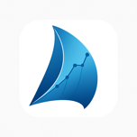
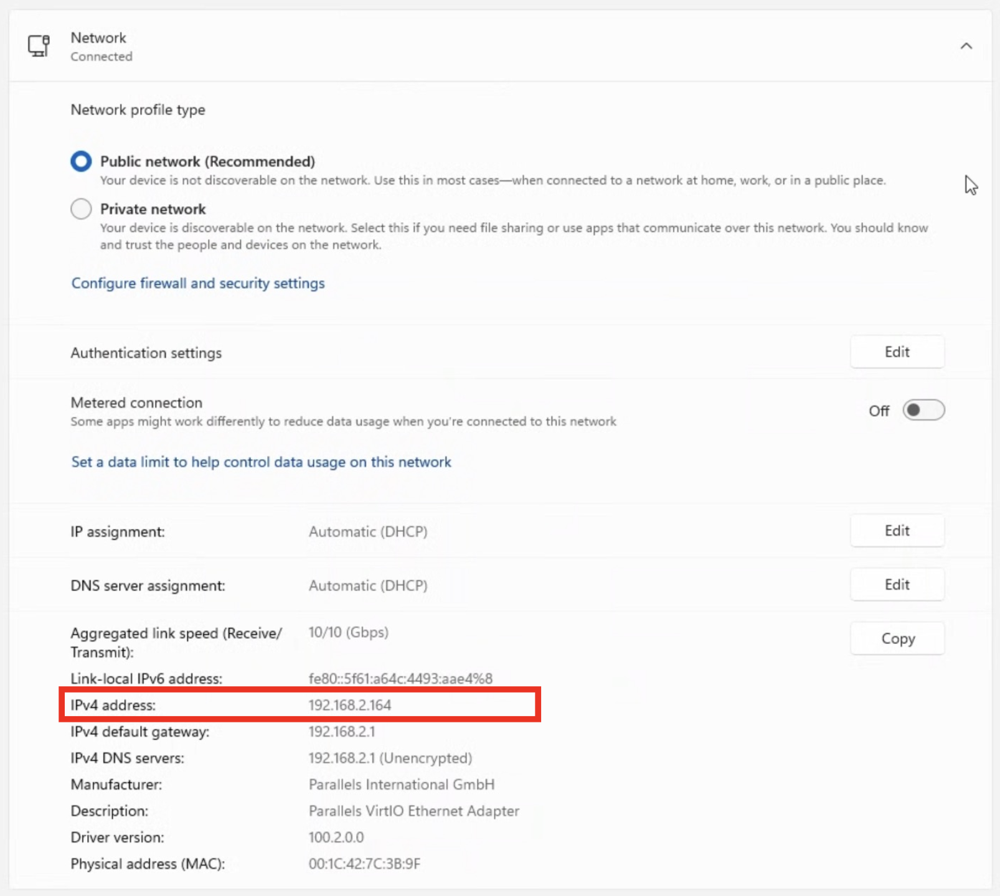
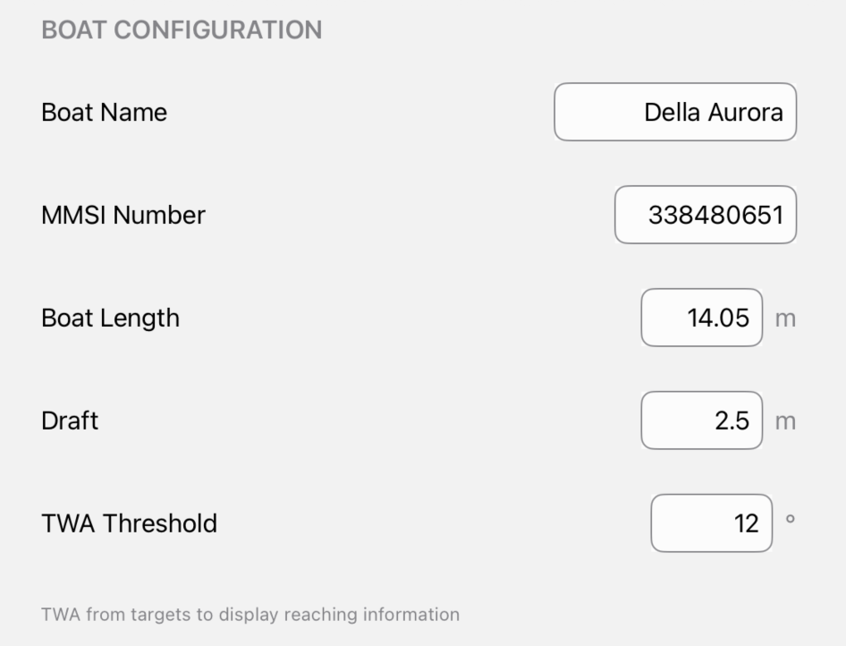

# SailWatchPro

<p align="center">
  <a href="https://sailwatchpro.com/">
    
  </a>
</p>

<p align="center">
  <strong>Setup Guide</strong>
</p>

---

## Table of Contents

- [How Setup Works](#how-setup-works)
- [Recommended Network Architecture](#recommended-network-architecture)
- [Step 1 — Configure Expedition Marine](#step-1--configure-expedition-marine)
- [Step 2 — Create Your Account and Add Your Boat](#step-2--create-your-account-and-add-your-boat)
- [Step 3 — Set Up Data Sources on the Web](#step-3--set-up-data-sources-on-the-web)
- [Step 4 — Load the Rest of the Boat on the Web](#step-4--load-the-rest-of-the-boat-on-the-web)
- [Step 5 — Install the App and Import Setup](#step-5--install-the-app-and-import-setup)
- [Step 6 — Import Crew and Competitors](#step-6--import-crew-and-competitors)
- [Step 7 — Settings on Each Device](#step-7--settings-on-each-device)
- [Keeping Devices in Step](#keeping-devices-in-step)
- [Safety Settings](#safety-settings)
- [Troubleshooting](#troubleshooting)
- [Support & Updates](#support--updates)

---

## How Setup Works

SailWatchPro is configured on the website, not on each iPad.

The boat owner signs in at [sailwatchpro.com](https://sailwatchpro.com), adds the boat, and sets up everything the boat needs: where the instruments come from, polars, sail charts, crew, events and competitors. Each iPhone or iPad then signs in with its own account and taps **Import Setup**, which pulls that configuration down. Change something on the web later and run Import Setup again on every device.

What you need before you start:

- Something for the app to hear: a boat PC running **Expedition Marine**, an **NMEA 2000 gateway**, a **B&G display network**, or just the iPad's own GPS. Expedition Marine is optional; a boat without it skips Step 1 and takes everything from the gateway.
- An onboard router that the PC, the gateway and the iPads all share
- An email address for the owner's account, and one for each crew member who will run the app
- An internet connection for the web setup and for the first import. On the water the app runs fully offline.

**All iOS devices (iPhone, iPad and Watch) should run the same version of the app**, as data is shared between them.

---

## Recommended Network Architecture

A stable, low-latency onboard network is the foundation of a reliable SailWatchPro installation. The recommended setup uses a **wired backbone** for the critical components, with iPads and iPhones connecting via WiFi.

```
                        [ Onboard Router ]
                       /        |         \
              (ethernet)   (ethernet)    (WiFi)
                 /              |              \
    [ Expedition PC ]  [ NMEA 2000 Gateway ]  [ iPads / iPhones ]
```

### Wired Components

**Onboard Router**
The router is the hub of the network. Common choices on racing boats include the Pepwave, D-Link, and Starlink. The router should be connected to the boat's power supply and positioned for strong WiFi coverage across the cockpit and nav station.

**Expedition PC** (only on boats that run Expedition)
The Expedition Marine PC should be connected to the router via an Ethernet cable, not WiFi. A wired connection eliminates latency and dropout issues that can occur when the PC is on WiFi and ensures that Expedition's UDP broadcasts reach SailWatchPro reliably.

**NMEA 2000 Gateway**
The gateway puts your boat's NMEA 2000 instrument data on the Ethernet network, where Expedition Marine and SailWatchPro can hear it. Expedition does not forward AIS targets, so a boat that wants competitor positions from AIS needs a gateway even when Expedition is aboard.

SailWatchPro has ready-made settings for these:

| Gateway | How the app hears it |
|---------|----------------------|
| **Yacht Devices** (YDWG-02 WiFi, YDEN-02 Ethernet) | NMEA 0183 on UDP 10110, raw N2K on UDP 1457 |
| **Actisense** W2K-1 | UDP 60001 |
| **B&G display network** (H5000 or Hercules processor) | WebSocket on port 2053, by the processor's address |

Any other gateway that sends NMEA 0183 over UDP or TCP can be added as a custom source with its address and port. A Quark-elec QK-A026, for example, serves NMEA 0183 on TCP port 2000.

The gateway should also be connected to the router via Ethernet where it has a port.

### WiFi Devices
iPads, iPhones and Apple Watches connect to the router via WiFi. For best results:
- Use the **5 GHz band** if your router supports it. It suffers less interference than 2.4 GHz in marina environments.
- Keep devices within good range of the router. See the signal strength guidance in the [Troubleshooting Guide](TROUBLESHOOTING.md).
- Make sure the router does **not** have AP Isolation (also called Client Isolation) enabled. It prevents devices from talking to each other.

---

## Step 1 — Configure Expedition Marine

Skip this step if the boat does not run Expedition.

SailWatchPro finds Expedition on the network by itself. You do not enter the PC's address anywhere in SailWatchPro. Expedition, however, needs to be told where to send its data: the **broadcast address** of the boat network, which reaches every device on it. To work that out you need the PC's own address.

**Find the Expedition PC's IP address:**
1. Open a Windows Command Prompt:
   - **Native Windows PC:** press **Windows Key + R**, type `cmd`, press Enter
   - **Mac running Parallels:** click the **Start menu** with your mouse, type `cmd`, press Enter
2. Type `ipconfig` and look for **IPv4 Address** under your active network adapter
3. Note this IP (example: `192.168.1.50`). The boat network's broadcast address is the first three numbers followed by `.255`: here, `192.168.1.255`.

<div align="center">
  
  <br><em>The Expedition PC's IP address</em>
</div>
<br>

**Add a network connection for SailWatchPro:**

1. Start Expedition Marine on the boat PC
2. From the ☰ Hamburger Menu, drag down, hover over **Instruments**, and click **Number of network connections**
3. Enter one greater than the displayed number and click **OK**
4. Go back to **Instruments**, select the new network and configure:
   - **Alias:** SailWatchPro
   - **Instruments:** Expedition
   - **Address:** the boat network's broadcast address, ending in `.255` (example: `192.168.1.255`). Not the PC's own address: data sent there never leaves the PC. `255.255.255.255` also works on most networks, but the `.255` form is the one to use when the PC is a virtual machine or data is not arriving.
   - **Port:** 5099
5. Click **Expedition Settings**
6. In **Exp Rx filter**, check **Receive marks**
7. In **Exp Tx filter**, enable every channel listed in [EXPEDITION-CHANNELS.md](EXPEDITION-CHANNELS.md). If you also upload logs to the web portal or replay them in the app, tick the same channels under **Settings ▸ Logging** as well, plus the log-only ones listed in that document: logging is a separate list from the Tx filter.

**Expedition in Parallels on a Mac.** The Windows virtual machine must be on the boat network itself, not hidden behind the Mac. On the Mac, not in Windows, open **Parallels → [the VM] → Configure → Hardware → Network → Source** and choose the Mac's actual Wi-Fi or Ethernet adapter, not **Shared Network**. The tell-tale of Shared Network is that Windows can ping the iPad but the iPad cannot ping Windows. Check the Windows IP again afterwards; it changes when the mode does, and the broadcast address with it.

**Ports.** The two sides mirror each other:

| Application | Rx Port (Receive) | Tx Port (Transmit) |
|-------------|-------------------|-------------------|
| **Expedition Marine** | 5098 | 5099 |
| **SailWatchPro** | 5099 | 5098 |

These are the defaults on both sides. You only need to touch them if 5099 is already taken on your PC, in which case change the port here and on the boat's Expedition data source in Step 3.

---

## Step 2 — Create Your Account and Add Your Boat

1. Go to [sailwatchpro.com](https://sailwatchpro.com) on a computer and click **Sign In**, then **Sign Up**
2. Enter your email address and choose a password. Confirm your email from the message you receive.
3. Under **My Boats**, add your boat. You need only the **Boat Name**; the **MMSI** is optional and can come later.

Open the boat. Its page is a grid of cards, one per topic: Events, Logbook, Calibration, Polars & targets, Sails, Marks & courses, Crew, Competitors, Documents & config, Data sources, and more. Steps 3 and 4 work through the cards that matter for a first setup.

For subscriptions, the beta programme and how the licence reaches your devices, see the [Subscription & Licensing Guide](SUBSCRIPTION-AND-LICENSING.md). Nothing in it needs typing into the app: once the boat is licensed, every device that imports the boat picks the licence up.

---

## Step 3 — Set Up Data Sources on the Web

Open the boat's **Data sources** card. This is where you tell the app where the boat's instruments come from. Add one source per thing that talks on the network.

**Expedition.** Choose the Expedition preset. It needs no address, because the app learns which machine is talking and a laptop's IP changes with every DHCP lease. The receive and send ports default to 5099 and 5098. Expedition supplies position and boat data but not AIS.

**NMEA 2000 gateway.** Choose the Yacht Devices or Actisense preset, or add a custom source. A custom source needs a **Name**, a **Connection** (UDP listen, TCP connect or WebSocket), the gateway's **Address** where the connection dials out, and the **Receive port**. **Expect** tells the app what framing to look for and is filled in by the presets.

**B&G displays.** Choose the B&G display network preset and enter the H5000 or Hercules processor's address. **Send start line and start time to B&G**, on the same page, lets the app push the pinged line and the start time to the displays.

**What each source provides.** Every source is marked for what the app should take from it: GNSS, boat data, or AIS. A typical Expedition boat has two rows: Expedition for position and boat data, and a gateway restricted to AIS. A boat with no GNSS on the bus can take position from the iPad itself with the Device source. A boat without Expedition has a single gateway row providing all three, or a gateway for boat data and AIS with position from the Device source.

Save the page. Every iPad that imports the boat will listen on exactly these sources.

<!-- screenshot needed: the Data sources page with an Expedition row and an AIS-only gateway row -->

---

## Step 4 — Load the Rest of the Boat on the Web

Still on the boat's page on the web:

| Card | What to do |
|------|------------|
| **Polars & targets** | Upload the boat's polar files. There are slots for the navigation polar, performance polar, start polar, heel and more. Forestay target loads per wind speed and the forestay maximum live here too. |
| **Sails** | Upload the sailmaker's crossover chart (Expedition `.txt` or `.xml`) and record the sail inventory. Sails you mark as left ashore stay off the crew's iPads. |
| **Crew** | Add each crew member by email. Crew members sign in to the app with that same email, so this is what lets their iPads import the boat. |
| **Events** | Create the regatta or race. Competitors are attached to an event. |
| **Competitors** | Enter the fleet for the event. |
| **Documents & config** | Three things here matter for setup. **Boat Info** holds the MMSI, sail number and call sign. **Boat Configuration** holds Length, Draft, Bow to GPS, Mast Height, Reaching Threshold from Target TWA, Minimum Tactical Wind and the wind bands; these drive distances in boat lengths, depth alerts and sailing-mode detection on every device. **AI / Weather Briefings** takes an Anthropic API key if you want AI briefings on the boat. The key stays on the server; no device holds it. The owner's Anthropic account is billed, roughly a cent per briefing. Create a key at https://platform.claude.com/settings/keys and fund it at https://platform.claude.com/settings/billing. |
| **Marks & courses** | Optional. Marks and courses can also come straight from Expedition on the boat. |
| **Channel names** | Optional. Rename Expedition's numbered user channels so they read sensibly on the dashboards. |

Everything on this page flows to each device on Import Setup.

---

## Step 5 — Install the App and Import Setup

1. Install SailWatchPro on each iPhone and iPad via TestFlight.
2. **First launch** takes a few extra moments while the app performs a one-time installation of the ECMWF libraries.
3. Open **Settings**:
   - iPad → Settings
   - iPhone → More > Settings
4. Under **Account**, tap **Sign In or Create Account** and sign in with your email and password. Crew members use the email the owner added to the roster. A crew member who has no account yet creates one here with that same email.
5. Tap **Import Setup**. The app downloads the boat's data sources, sail charts, polars, forestay targets, tuning tables and boat details. If your account has access to more than one boat, pick the right one.
6. Look for **green** status indicators under **Data Sources** in Settings. The Expedition row shows which machine the commands are going to.

<!-- screenshot needed: Settings → Account signed in, with the Import Setup button -->

If the app says the account has no boats yet, the boat has not been added on the website, or you are crew and the owner has not added your email to the roster. Fix that on the web and tap **Try again**.

To change which boat a device is on, use **Switch boat from web** in Settings.

---

## Step 6 — Import Crew and Competitors

Crew and competitors come down separately from the boat setup, because they change from event to event.

1. Open the **Crew** screen in the app
2. Tap **Import Crew & Competitors for Event**
3. Choose the event

The roster appears on the Crew screen and the fleet on the Competitors screen. A single competitor can still be added by hand on the Competitors screen with **Add Competitor**.

<!-- screenshot needed: Crew screen with the Import Crew & Competitors for Event button -->

---

## Step 7 — Settings on Each Device

A few things are decided per device rather than per boat. Open **Settings** in the app.

**Data Sources**
- **Receive gateway data**: on by default. Turn it off on crew iPads that do not need AIS targets, to save the network and the battery.
- **Expedition commands**: not a setting, but shows which Expedition machine the app is sending to. A second Expedition on the network shows up here.
- **Allow Coordinator Role**: whether this device may be elected the boat's coordinator, the one iPad that hands the plan to the others, writes to B&G displays and records the race for the Logbook. Leave it on for the nav-station iPad; turn it off on crew devices that come and go. See the [User Manual](USER-MANUAL.md#the-boats-devices).
- **Use B&G displays to start the race timer**: on a boat with a B&G display network source, lets a keypress on a display start the countdown on this device.

**Boat Configuration**
Boat Name, MMSI, Boat Length, Bow to GPS, Draft, Max Forestay Load, Reaching Threshold and Minimum Tactical Wind arrive from the web on Import Setup. Check them once. To change one, change it on the web under Documents & config and import again, so every device agrees.

<div align="center">
  
  <br><em>Boat Configuration, filled in from the web</em>
</div>
<br>

**Display**
- **Night Vision** switches the whole app to red-on-black. Light and dark mode otherwise follow iOS: **Settings > Display & Brightness > Appearance**.

**AI Weather Briefings**
- **Enable AI briefings** uses the key the owner set on the web. Switch it off for races that prohibit paid services; the app then makes no connection to Claude.

**Weather Intelligence**
- **Enable forecast monitoring** polls the weather models hourly across the race area. Needs internet.

**Buoys**
- The buoy list seeds itself from the cloud catalog. Sync the catalog from the Buoys section to pick up new weather stations as they are added, and manage your own personal list there.

---

## Keeping Devices in Step

When something changes on the web, run **Import Setup** again on every iPad. Until you do, that iPad is racing on the older setup: it may listen on different sources, show a different course, or have an older sail chart. The app warns when it notices another iPad has newer data.

Crew and competitors are refreshed from the Crew screen with **Import Crew & Competitors for Event**, not from Import Setup.

Keep every device on the same build. Builds are announced through TestFlight.

---

## Safety Settings

| Setting | Description |
|---------|-------------|
| **Depth Alerts** | Automatic warnings based on draft + safety margin |
| **Audio Countdown** | Spoken start sequence announcements |
| **MOB (Man Overboard)** | Emergency position marking and tracking |

> Safety depth alerts only activate when **Draft** is set to a value greater than 0 in Boat Configuration.

---

## Troubleshooting

If you see red status indicators, nothing arrives from Expedition or the gateway, or Import Setup fails, see the full [Troubleshooting Guide →](TROUBLESHOOTING.md) for network diagnostics, firewall configuration and common fixes.

---

## Support & Updates

SailWatchPro is actively developed with new features based on user feedback and racing experience. Keep iPhone, iPad and Watch apps on the same version for best results.

**Support:** support@sailwatchpro.com

**Feature requests and bug reports:** https://github.com/jbistis/SailWatchPro-Public/issues

Happy sailing! ⛵
**SailWatchPro Team**
