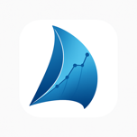

# SailWatchPro

<p align="center">
  <a href="https://sailwatchpro.com/">
    
  </a>
</p>

<p align="center">
  <strong>Subscription & Licensing Guide</strong>
</p>

---

## Table of Contents

- [Overview](#overview)
- [Plans](#plans)
- [Choosing a Plan for Your Boat](#choosing-a-plan-for-your-boat)
- [How the Plan Reaches Your Devices](#how-the-plan-reaches-your-devices)
- [Your License Key](#your-license-key)
- [Your Crew](#your-crew)
- [Renewals](#renewals)
- [Canceling](#canceling)
- [Managing Your Subscription](#managing-your-subscription)
- [Multiple Boats](#multiple-boats)
- [Beta Program](#beta-program)
- [Troubleshooting](#troubleshooting)
- [Privacy](#privacy)
- [Support](#support)

---

## Overview

The SailWatchPro app is free. Every boat gets the dashboards, the start tool, the race-day map, buoys, sail controls, MOB and the safety advisories on every device, with no plan at all.

A plan unlocks the paid half: the advisories after the gun, the chart map with routing, forecast, currents and depths, competitors, the instrument log, and on the web, log upload and post-race analysis.

A plan belongs to the **boat**, not to a person. One plan covers every iPhone, iPad and Apple Watch aboard and every crew member on the roster, with no per-user fees. There is nothing to paste or scan: sign in, import the boat, and the plan is there.

---

## Plans

Prices are announced at launch. Every plan is annual and renews automatically.

### Free

Any boat, ashore and on the water.

- The web app: season planning and events, crew roster, availability and watch bill, live buoys for your racing area, sails, provisioning, to-dos and boat documents, and the playbook
- The iOS app on iPhone, iPad and Apple Watch: live instrument dashboards, the start timer and line pings, the race-day map, buoys, sail controls and MOB
- Unlimited crew members

### Instruments — $TBD/year

Race better from your boat's instruments. The plan for a boat without Expedition Marine, or one that does not need the integration. Everything in Free, plus:

- Advisories on the water: rounding, douse, weather and sail calls
- The chart map: NOAA charts and depths, with weather routing from the forecast and the current aboard
- Competitors: the fleet from AIS and the network, on the map and in their own list
- Instrument log recording, and post-race analytics with video replay
- AI weather briefings
- Email support

### Expedition — $TBD/year

The full program, with Expedition Marine below deck. Everything in Instruments, plus:

- The same app on deck, integrated with Expedition Marine below: data channels, marks, courses, timers, events, polars and sails, and its log files for analysis
- Input variables for Expedition Marine's advanced routing, based on model accuracy
- Instrument calibration, polars and targets
- Priority support

Expedition buys the Expedition Marine integration and the support that goes with it, not more of the app. Both paid plans unlock the same features on the iPad.

### Beta

Free, by invitation, for active racers who give regular feedback while the app is in TestFlight. A beta plan unlocks everything a paid plan does. See [Beta Program](#beta-program).

---

## Choosing a Plan for Your Boat

### Step 1 — Sign In

Go to [sailwatchpro.com](https://sailwatchpro.com) and click **Sign In**. New here? Click **Sign up**, enter your email and choose a password, then confirm your email from the message you receive. There is a **Forgot password?** link on the sign-in page if you need it.

### Step 2 — Add Your Boat

Under **My Boats**, add your boat with its **Boat Name**. The **MMSI** is optional. Nothing else is needed to start; the boat begins on the Free plan.

### Step 3 — Subscribe

Open the boat. Its page shows the subscription with two buttons, **Subscribe — Instruments** and **Subscribe — Expedition**. Click one and you are taken to Stripe Checkout to pay. Stripe handles the card; SailWatchPro never sees it.

When payment completes you receive an email, **Your SailWatchPro plan is active**, naming the boat, the plan and the renewal date. The boat's page shows **Active** and the date it renews.

---

## How the Plan Reaches Your Devices

1. Install SailWatchPro on each iPhone and iPad. Set up the boat as described in the [Setup Guide](SETUP-GUIDE.md).
2. In the app, open **Settings**, sign in with the account you use on the web, and tap **Import Setup**.
3. That is all. The plan arrives with the boat's configuration. **Settings → Account** shows the plan, where it came from and when it renews.

Two paths deliver the plan:

- **Signing in.** The owner, anyone the boat is shared with, and every crew member on the roster receives the plan when they import the boat, ashore or afloat.
- **Aboard.** Any device on the boat's network picks the plan up from the boat's coordinator, the iPad the boat's devices elect to answer for the boat (see [The Boat's Devices](USER-MANUAL.md#the-boats-devices) in the User Manual). A device that got its plan this way keeps it for 45 days without hearing a coordinator, and renews it every time it hears one.

Once a device holds the plan it works fully offline. Nothing is checked at sea.

The app has no key field, no QR scanner and no purchase button. Plans are bought and managed on the web only. A locked feature in the app says which plan has it and nothing more.

---

## Your License Key

Behind the scenes the plan travels as a license key, which looks like:

```
SWPRO-MnwzM2U2...
```

It names your boat, the plan and an expiry date, and carries a signature so the app can verify it offline. The key is included in your plan email for reference if you ever need support. You never type it anywhere.

**Expiry.** A key runs to the subscription's renewal date plus one week. When the subscription renews, a fresh key is minted. The app also allows a 30-day grace after a key's date before the paid features switch off, so a late renewal never catches you on the start line.

**Expedition Site Code.** If the boat runs Expedition Marine, the app sees Expedition's Site Code on the network and records it against the boat by itself. The Site Code follows the laptop, not the hull; if you replace the laptop or move it to another boat, the owner can re-link it on the web under **Documents & config → Technical Configuration**.

---

## Your Crew

A single plan covers the whole crew.

1. On the web, open the boat's **Crew** card and add each crew member by email.
2. Each crew member installs the app, signs in with that email, and taps **Import Setup**. The plan comes with the boat.
3. A crew member who has not imported yet still gets the plan aboard, from the coordinator, as soon as they are on the boat's network.

A crew member who sails on several boats uses **Switch boat from web** in Settings; it lists every boat whose roster they are on. The plan belongs to the boat, so nobody needs one of their own.

A coach can be added to a boat with permission to upload logs and review the Logbook, with an end date so the access lapses when the engagement does.

There is no hard limit on devices. A plan is for one boat's program; a second boat needs its own.

---

## Renewals

Subscriptions renew annually on the anniversary of the first payment.

**A new key is minted on renewal.** When the payment goes through, a fresh key with the new date is created and emailed to you. Devices pick it up the next time they sign in or run **Import Setup**, and aboard, from the coordinator. With the one-week margin on the old key and the app's 30-day grace, there is no gap to manage.

**If your card fails.** Stripe retries over several days and emails you. The boat's page shows **Past Due**. Your existing key keeps working through its margin and the app's grace. Update the card from **Manage Subscription** on the boat's page.

---

## Canceling

Click **Manage Subscription** on the boat's page and cancel there. The plan stays active through the end of the period you have paid for; there are no prorated refunds. The boat's page then shows **Canceled**.

When the key runs out, the boat drops back to Free. The web app keeps working, and so does the iOS app with its dashboards, start timer and race-day map. The paid half switches off until you subscribe again, which you can do at any time from the same page.

---

## Managing Your Subscription

The boat's page on the web shows:

- **Status**: Active, Past Due, Canceled, Incomplete, or Not Subscribed
- **Renews**: the date of the next payment
- **Manage Subscription**: opens Stripe's customer portal to update the card, download invoices, see payment history or cancel

Stripe's portal handles all card data. SailWatchPro never sees or stores card details.

---

## Multiple Boats

Add each boat under **My Boats**. Each boat has its own plan, its own key and its own billing date, independent of the others. You can put one boat on Instruments and another on Expedition, or leave one on Free.

In the app, **Switch boat from web** in Settings moves a device from one boat to another, and brings that boat's plan with it.

---

## Beta Program

While the app is in TestFlight, the beta program provisions a free plan for active racers who will use the app in real racing and report what they find.

**Requesting access.** Sign in at sailwatchpro.com, add your boat, and use **Join the iOS beta** on the boat's page. Requests are matched to the boat owner's email. When the boat is provisioned you receive the plan email with the TestFlight link.

**How it works.** A beta plan is a subscription at no charge. It runs to its anniversary like a paid plan, and renews unless we end it. When the beta program closes, each beta boat is offered its plan, Instruments or Expedition, at a founding-member price. Nothing changes on your devices either way; the plan name updates by itself.

**What we ask.** Use the app during real racing, not just at the dock. Report bugs, crashes and surprises promptly through [GitHub Issues](https://github.com/jbistis/SailWatchPro-Public/issues) or by replying to the plan email. Share suggestions, and answer the occasional check-in.

---

## Troubleshooting

### A feature says "Available on the Instruments plan"

The device does not hold a plan yet. In order:

1. On the web, open the boat's page. If the status is **Not Subscribed**, **Canceled** or **Incomplete**, the boat has no current plan; subscribe or resume.
2. In the app, check **Settings → Account**. Make sure you are signed in with the email that owns the boat or is on its roster, and that the right boat is selected. **Switch boat from web** lists the boats you have access to.
3. Tap **Import Setup**. The plan comes down with the boat.
4. Aboard, make sure the device is on the boat's network. The coordinator shares the plan with every device it can hear.

### The plan shows on one device but not another

The second device has not imported the boat, is signed in with an account that is not on the roster, or is not on the boat's network. Sign in on it and run **Import Setup**, or get it onto the boat's WiFi where the coordinator will reach it.

### The plan email did not arrive

Check spam, and the quarantine if your mail is filtered. The plan is not held up by the email: it is already on the boat, so a device that imports the boat gets it regardless. For a copy of the key, write to support@sailwatchpro.com.

### A Subscribe button shows an error

The message names the cause, for example a Stripe error. Refresh and try again; if it repeats, send the message to support@sailwatchpro.com.

---

## Privacy

SailWatchPro keeps your account email, the boats and crew you set up, your subscription status and the race data the app and the web app record while you use them. Payment details are handled entirely by Stripe. We do not sell personal data, show advertising or track you across other sites.

The full policy is at [sailwatchpro.com/privacy](https://sailwatchpro.com/privacy). Questions about it go to legal@sailwatchpro.com.

---

## Support

- **Account, plan and billing questions:** support@sailwatchpro.com, or reply to your plan email
- **Bugs and feature requests:** [github.com/jbistis/SailWatchPro-Public/issues](https://github.com/jbistis/SailWatchPro-Public/issues)
- **Setup and connection help:** the [Setup Guide](SETUP-GUIDE.md) and the [Troubleshooting Guide](TROUBLESHOOTING.md)

Happy sailing! ⛵
**SailWatchPro Team**
