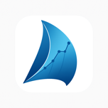

# SailWatchPro Troubleshooting Guide

<p align="center">
  <a href="https://sailwatchpro.io/">
    
  </a>
</p>

<p align="center">
  <strong>Connection & Performance Troubleshooting</strong>
</p>

---

## Table of Contents

- [Connection Issues](#connection-issues)
  - [Understanding the Connection Status Indicator](#understanding-the-connection-status-indicator)
  - [Test Network Connectivity](#test-network-connectivity)
  - [Check WiFi Signal Strength](#check-wifi-signal-strength)
  - [Verify Port Settings](#verify-port-settings)
  - [Windows Firewall Configuration](#windows-firewall-configuration)
  - [The Cloud: Is This Device Reaching sailwatchpro.com?](#the-cloud-is-this-device-reaching-sailwatchprocom)
- [Getting In](#getting-in)
  - [The App Asks Me to Sign In](#the-app-asks-me-to-sign-in)
  - [Join Does Not Appear at the Door](#join-does-not-appear-at-the-door)
- [Data Sync Issues](#data-sync-issues)
- [Display Problems](#display-problems)
  - [A Tile Shows an Amber or Red Dot, or a Grey Dash](#a-tile-shows-an-amber-or-red-dot-or-a-grey-dash)
  - [Some Instruments Arrive and Others Do Not](#some-instruments-arrive-and-others-do-not)
  - [Taps and Swipes on the Dashboard Do Nothing](#taps-and-swipes-on-the-dashboard-do-nothing)
  - [The iPhone Screen Goes Dark on a Dashboard](#the-iphone-screen-goes-dark-on-a-dashboard)
- [Performance Issues](#performance-issues)
- [Common Error Messages](#common-error-messages)
- [Still Need Help?](#still-need-help)

---

## Connection Issues

### Verify Network Architecture

Before working through the steps below, confirm your onboard network is set up as recommended — with the Expedition PC and NMEA 2000 gateway both hardwired to the router, and iPads/iPhones on WiFi. A wired Expedition PC eliminates the most common source of intermittent connection problems.

See [Recommended Network Architecture](SETUP-GUIDE.md#recommended-network-architecture) in the Setup Guide.

---

### Symptoms
- Orange or red connection indicator in SailWatchPro
- No data appearing from Expedition Marine
- Intermittent connection drops
- Can receive data but cannot send commands

---

### Understanding the Connection Status Indicator

SailWatchPro displays a single connection symbol in the toolbar that shows exactly
what is happening between the app and Expedition Marine. This replaces the old
two-dot indicator system.

| Symbol | Meaning |
|--------|---------|
| **EM — SWP** | No connection at all |
| **EM → SWP** | Receiving data from Expedition but cannot send commands back |
| **EM ← SWP** | Can reach Expedition but not receiving data |
| **EM ↔ SWP** | Full bi-directional connection confirmed ✅ |

**Color coding:**
- 🟢 Green = Full connection (EM ↔ SWP)
- 🟠 Orange = Partial connection (EM → SWP or EM ← SWP)
- 🔴 Red = No connection (EM — SWP)

**What each state tells you:**

**EM → SWP (orange)** is the most common problem state. It means Expedition Marine
is broadcasting data and SailWatchPro is receiving it, but commands from SailWatchPro
are not reaching Expedition. Boat data will display on screen but timer commands,
course selection, and other controls will not work. This is almost always caused by:
- Wrong IP address in Settings → Expedition Marine
- Windows Firewall blocking inbound connections on ports 5098/5099
- See [Windows Firewall Configuration](#windows-firewall-configuration)

**EM ← SWP (orange)** means SailWatchPro can reach Expedition but is not receiving
data back. This is an unusual network condition. Check that Expedition Marine is
running and that your instruments are powered on.

**EM — SWP (red)** means no communication in either direction. Both devices may be
on different networks, the IP address may be wrong, or Expedition Marine may not
be running.

> **Important:** Expedition Marine broadcasts most data packets to the entire subnet
> (255.255.255.255), so boat position, wind, and speed data can appear on screen
> even when the IP address in Settings is wrong. The **EM → SWP** state specifically
> catches this case. If you can see boat data on screen but timer and course commands
> do not work, check your IP address in Settings → Expedition Marine first before
> investigating firewall or port issues.

**Tip:** After changing the IP address or ports in Settings, tap Done and the app
will immediately attempt a fresh connection. The indicator should update within a
few seconds.

### The Cloud: Is This Device Reaching sailwatchpro.com?

The cloud at the end of the toolbar's status group is about the web app, not the
boat. The app checks by asking the web app itself about once a minute, so a boat's
Wi-Fi, or a B&G display's, that says "connected" with no internet behind it shows
as offline, not connected.

| Cloud | Meaning | What to do |
|-------|---------|------------|
| 🟢 Green | Signed in, and the web app answered in the last few minutes | Nothing |
| ⚪ Grey, slashed | No internet right now | Nothing. Normal on the water: uploads wait on the device and go out by themselves when there is internet |
| 🔴 Red | Signed out, or the server refused to renew the sign-in | Sign in again under **Settings → Account** |

Tap the cloud for who is signed in, when the web app last answered, and how many
uploads are waiting. A sign-in that lapsed only because there was no internet shows
grey, not red: it renews by itself once a connection returns.

---

### Test Network Connectivity

**Step 1: Find IP Addresses**

**Find your Expedition PC's IP address:**
1. Open Command Prompt in Windows:
   - **Windows PC:** Press **Windows Key + R**
   - **Mac keyboard (VM):** Press **Command (⌘) + R** or click the Windows Start menu
2. Type `cmd` and press Enter
3. Type `ipconfig` and look for **IPv4 Address** under your active network adapter
4. Write down this IP (example: 192.168.1.50)

**Find your iPad's IP address:**
- Settings → Wi-Fi → Tap the (i) icon → IPv4 Address
- Write down this IP (example: 192.168.1.100)

---

**Step 2: Test Connection from iPad to PC**

**From your iPad/iPhone:**
1. Install [Ping - Network Utility](https://apps.apple.com/us/app/ping-network-utility/id576773404)
2. Open the app and ping your Expedition PC's IP address
3. If successful, you'll see replies with response times

---

**Step 3: Test Connection from PC to iPad**

**From your Expedition PC:**
1. Open Command Prompt (already open from Step 1, or press **Windows Key + R**, type `cmd`)
2. Type: `ping` followed by your iPad's IP address
   - Example: `ping 192.168.1.100`
3. Press Enter
4. If successful, you'll see replies with response times

---

**If ping works in both directions, your network is fine.** The issue is likely firewall or port configuration.

**If ping fails:**
- ✅ Verify both devices are on the same Wi-Fi network
- ✅ Check that no VPN is active on either device
- ✅ Restart your router and reconnect devices
- ✅ Check for "AP Isolation" or "Client Isolation" settings on your router (disable if enabled)

---

### Check WiFi Signal Strength

Weak WiFi signals can cause intermittent connections and data loss.

**Check signal strength on your iPad/iPhone:**
1. Install [WiFiman](https://apps.apple.com/us/app/wifiman/id1385561119) (free)
2. Open the app to see real-time signal strength

**Signal strength guide:**
- **-30 to -50 dBm** = Excellent ✅
- **-50 to -60 dBm** = Good ✅
- **-60 to -70 dBm** = Fair ⚠️ (may have issues)
- **-70 dBm or worse** = Poor ❌ (connection problems likely)

**If signal is weak:**
- Move closer to the router
- Reduce obstacles between device and router
- Consider adding a WiFi extender or access point
- Check for interference from other devices

---

### Verify Port Settings

Port configuration must be **opposite** between Expedition and SailWatchPro:

| Application | Rx Port (Receive) | Tx Port (Transmit) |
|-------------|-------------------|-------------------|
| **Expedition Marine** | 5098 | 5099 |
| **SailWatchPro** | 5099 | 5098 |

**Why opposite?** Expedition's Tx port (5099) must match SailWatchPro's Rx port (5099), and vice versa.

**To check in SailWatchPro:**
- Settings → Expedition Marine → Verify Rx and Tx ports

**To check in Expedition Marine:**
- Tools → Settings → Communications → UDP ports

**Common port issues:**
- ❌ Using same port for Rx and Tx on both apps
- ❌ Ports swapped (5098 where 5099 should be)
- ❌ Firewall blocking one or both ports

---

### Windows Firewall Configuration

**Quick Test: Temporarily disable firewall**

Open Command Prompt **as Administrator** and run:
```cmd
netsh advfirewall set allprofiles state off
```

Test your connection. If it works, the firewall was blocking UDP traffic.

**Re-enable firewall:**
```cmd
netsh advfirewall set allprofiles state on
```

---

**Permanent Fix: Add firewall rules for Expedition**

**Method 1: Add Port Rules**

1. Open **Windows Defender Firewall with Advanced Security**
   - Press Windows Key, type "firewall", select "Windows Defender Firewall with Advanced Security"
2. Click **Inbound Rules** → **New Rule**
3. Select **Port** → Click Next
4. Select **UDP** → Enter ports: `5098, 5099` → Click Next
5. Select **Allow the connection** → Click Next
6. Check all profiles (Domain, Private, Public) → Click Next
7. Name: "Expedition Marine UDP Ports" → Click Finish

**Method 2: Add Application Rule**

1. Open **Windows Defender Firewall with Advanced Security**
2. Click **Inbound Rules** → **New Rule**
3. Select **Program** → Click Next
4. Browse to `Expedition.exe` (usually in `C:\Program Files\Expedition`)
5. Select **Allow the connection** → Click Next
6. Check all profiles → Click Next
7. Name: "Expedition Marine" → Click Finish

---

### Still Having Connection Issues?

**Check these additional items:**

✅ **Same Network**
- Both devices must be on the same Wi-Fi network
- Some boats have multiple networks (2.4GHz and 5GHz) - use the same one

✅ **Expedition UDP Output Enabled**
- In Expedition: Tools → Settings → Communications
- Verify UDP output is enabled
- Broadcast IP should be your network's broadcast address, ending in `.255` (for example `192.168.1.255`), or `255.255.255.255`. It must be on the same subnet as the iPad: `192.168.2.255` sends nothing to devices on `192.168.1.x`.

✅ **Expedition in Parallels on a Mac**
- The VM's network must be **Bridged** to the Mac's Wi-Fi or Ethernet adapter, not **Shared Network**
- On the Mac, **Parallels → [VM] → Configure → Hardware → Network → Source**
- Symptom of Shared Network: Windows can ping the iPad, but the iPad cannot ping Windows

✅ **Router AP Isolation**
- Some routers have "AP Isolation" or "Client Isolation" enabled
- This prevents devices from communicating with each other
- Check router settings and disable if present

✅ **No VPN Active**
- VPNs can interfere with local network communication
- Disable VPN on both devices while using SailWatchPro

✅ **Restart Services**
- Restart Expedition Marine
- Force quit and restart SailWatchPro
- Restart router if issues persist

---

## Getting In

The app opens to a door: **Sign in**, or **Join *your boat*** when the nav station's iPad is on the boat's Wi-Fi. Every device belongs to a boat. See [Step 5 of the Setup Guide](SETUP-GUIDE.md#step-5--install-the-app-and-import-setup).

### The App Asks Me to Sign In

**Expected** once, the first time the app runs on a device, and after signing out. A device that has signed in once goes straight in from then on, with or without internet.

**Not expected** on a device that had signed in before and was not signed out. Then one of two things happened:

- The server refused to renew the sign-in, because the account's password changed or the session was revoked. The cloud in the toolbar was red before the restart. Sign in again.
- The app was deleted and reinstalled, which clears the kept sign-in. Sign in again.

A crew phone that got in by **Join** sees the door again only when its 45 days have run out and no coordinator is on the network. Get it onto the boat's Wi-Fi with the nav station's iPad running, and the door offers Join again.

### Join Does Not Appear at the Door

The door offers **Join *your boat*** only while it hears the boat's coordinator. Check, in order:

1. **The nav station's iPad is signed in, with the boat picked.** A coordinator with no boat cannot let anyone in. Settings on that iPad shows **This iPad is the boat's coordinator** when it is.
2. **Both devices are on the same Wi-Fi.** The boat's network, not a phone's hotspot or the marina's.
3. **Allow Coordinator Role** is on, on that iPad, under Settings → Data Sources.
4. **Give it a minute.** The coordinator announces itself every 30 seconds; the door updates when it hears it.
5. **Both devices are on the same build.** An older build is heard but not trusted (see [The Boat's Devices](USER-MANUAL.md#the-boats-devices)), and build 180 or earlier does not know the door at all.

With no signed-in iPad aboard and no internet, nobody new gets in. Sign in ashore.

---

## Data Sync Issues

### Sail Changes Not Syncing Between Devices

**Symptoms:**
- Hoist a sail on iPad A, it does not appear on iPad B
- Crew positions not updating across devices
- Race setup, start line or course differs between iPads

**How it works:** every SailWatchPro device on the boat's WiFi talks to the others on its own UDP channel (port 5100, separate from Expedition). The devices elect one coordinator. See [The Boat's Devices](USER-MANUAL.md#the-boats-devices) in the User Manual.

**Troubleshooting:**

1. **Same network, no isolation**
   - Every device on the same WiFi, same band
   - Router's AP or Client Isolation off; it blocks the devices from hearing each other even when each can reach Expedition

2. **Same build**
   - Every device on the same version of the app. A device on an older build is heard but not trusted with changes, and cannot coordinate.

3. **Same boat and event**
   - Each device signed in and imported to the same boat (**Settings → Account**)
   - Crew and competitors imported for the same event on each device. A device holding a different event's roster is ignored for crew changes.

4. **A coordinator exists**
   - **Settings → Data Sources → Allow Coordinator Role** on for at least one device that stays aboard
   - Settings shows **This iPad is the boat's coordinator** on the one that is
   - If the coordinator is an iPad nobody can find, press **Make this iPad the coordinator** on the nav-station iPad

5. **Network**
   - Follow [Test Network Connectivity](#test-network-connectivity). The sync uses UDP broadcasts like Expedition's data, so whatever blocks one blocks the other.

---

## Display Problems

### Data Not Updating

**Symptoms:**
- Wind data frozen
- Speed/heading not changing
- Old timestamps on data

**Solutions:**

1. **Check connection status** (toolbar indicator)
   - EM ↔ SWP green = Connected ✅
   - EM → SWP orange = Receiving only — check IP address
   - EM — SWP red = No connection ❌
   - See [Understanding the Connection Status Indicator](#understanding-the-connection-status-indicator)

2. **Verify Expedition is running and broadcasting**
   - Check Expedition Marine is open
   - Verify data is updating in Expedition itself

3. **Restart connection**
   - Settings → Expedition Marine → Toggle connection off/on
   - Or force quit and restart SailWatchPro

4. **Check network connection**
   - Settings → Wi-Fi → Verify connected
   - Run ping test (see [Test Network Connectivity](#test-network-connectivity))

---

### A Tile Shows an Amber or Red Dot, or a Grey Dash

A dot beside a tile's name means its value has stopped arriving: amber first, then
red with the number dimmed, then a single grey dash in place of the number. Instruments and GPS go amber after about 3
seconds, red after 10 and the dash after 30; marks, laylines and the start allow 10, 30
and 60. The dot clears the moment data returns.

- **One sensor's tiles go together.** If apparent wind stops, true wind and the
  targets built on it go stale with it. Look at that sensor first: its cable, its
  power, and whether the instrument system itself still shows it.
- **Everything at once** points at the source: Expedition, the gateway or the
  boat's network. Check the toolbar indicator.
- **A value back from a dropout can be wrong for a minute.** After a wind sensor
  reconnects, its angle can read far off and settle over about a minute.

### Some Instruments Arrive and Others Do Not

Heading arrives but wind and GPS do not, or values come and go. Before suspecting
the app or Expedition, look at the instrument system's own display: on a B&G
processor, its web dashboard shows each sensor green or red.

If the instrument system is missing them too, check the NMEA 2000 backbone. With
the network powered off, measure the resistance between CAN-H and CAN-L: it should
be about **60 Ω**, two 120 Ω terminators, one at each end. **40 Ω** means a third
terminator, often built into a device; the bus then corrupts or drops messages, and
some sensors go silent while others carry on. Turn off that device's built-in
terminator if it has a switch, or move it to one end of the backbone in place of
that end's terminator.

### Taps and Swipes on the Dashboard Do Nothing

The dashboard is locked: the padlock in its toolbar is filled. Locked, a tap on a
tile does not change it and a swipe does not change the page. **Hold the padlock for
about a second** to unlock; a tap only shows "Hold to unlock". With **Full Screen
When Locked** on, the padlock is in the corner with MOB.

### The iPhone Screen Goes Dark on a Dashboard

**Pocket Mode** is on (**Settings → On Deck**). The proximity sensor at the top of
the iPhone darkens the screen while it is covered, in a pocket or face down, and
lights it again when uncovered. A thumb over the top of the screen covers it too.
Turn Pocket Mode off if that happens in your hand.

---

### Chart Data Not Displaying

**Symptoms:**
- Blank charts
- Missing historical data
- Charts show "No Data"

**Solutions:**

1. **Shorten time window**
   - Very long time ranges can be slow to load
   - Try shorter time window (1 hour instead of 24 hours)

2. **Clear and rebuild**
   - Settings → Advanced → Clear cache (if available)
   - Force quit and restart app

3. **Check data source**
   - Verify Expedition is sending the specific data type
   - Some data may not be available from your instruments

---

### Watch Not Syncing

**Symptoms:**
- Apple Watch shows old data
- Watch app not updating
- Watch shows "Connecting..."

**Solutions:**

1. **Check iPhone-Watch connection**
   - Swipe up on Watch → Check connected icon
   - iPhone → Watch app → My Watch → Verify paired

2. **Verify Watch Complications**
   - Watch face complications may need refresh
   - Force touch watch face → Customize → Re-add complication

3. **Restart both devices**
   - Force quit SailWatchPro on iPhone
   - Restart Watch app
   - If issues persist, unpair and re-pair Watch

4. **Check app versions**
   - iPhone and Watch must run same version of SailWatchPro
   - Update both if needed

---

## Performance Issues

### App Running Slow

**Symptoms:**
- Lag when switching screens
- Delayed button responses
- Choppy chart animations

**Solutions:**

1. **Reduce chart time windows**
   - Shorter time ranges = faster performance
   - Settings → Charts → Adjust default time windows

2. **Close background apps**
   - Double-click home button → Swipe up on unused apps
   - Free up memory for SailWatchPro

3. **Restart app**
   - Force quit SailWatchPro
   - Reopen fresh

4. **Restart device**
   - Power off iPad/iPhone
   - Wait 30 seconds
   - Power back on

---

### Battery Drain

**Symptoms:**
- Battery draining faster than expected
- Device getting hot

**Solutions:**

1. **Enable Night Mode**
   - Settings → Night Mode ON
   - Red-tinted display uses less power

2. **Reduce screen brightness**
   - Swipe down → Adjust brightness slider
   - Use lowest comfortable brightness

3. **Close unused apps**
   - Background apps consume battery
   - Close everything except SailWatchPro

4. **Disable unnecessary features**
   - Turn off features you're not using
   - Settings → Disable unused data displays

5. **Use Low Power Mode** (if critical)
   - Settings → Battery → Low Power Mode
   - Note: May affect performance

6. **Know what holds the screen on**
   - SailWatchPro keeps the screen on while a race screen is showing and data is
     arriving, the timer runs or a log plays (**Settings → On Deck → Keep Screen On
     While Racing**). After ten minutes with no data it lets the screen sleep.
   - On an iPhone in a pocket, **Pocket Mode** darkens the screen while the app
     keeps running.

---

## Common Error Messages

### "Unable to Connect to Expedition"

**Cause:** Network connection issue or Expedition not broadcasting

**Solution:**
1. Verify Expedition is running
2. Check IP address is correct (Settings → Expedition Marine)
3. Run ping test (see [Test Network Connectivity](#test-network-connectivity))
4. Check Windows Firewall (see [Windows Firewall Configuration](#windows-firewall-configuration))

---

### "Connection Timeout"

**Cause:** Network latency or weak WiFi signal

**Solution:**
1. Check WiFi signal strength (see [Check WiFi Signal Strength](#check-wifi-signal-strength))
2. Move closer to router
3. Restart router
4. Check for network congestion (too many devices)

---

### "Port Already in Use"

**Cause:** Another app is using the same UDP port

**Solution:**
1. Close other navigation/marine apps
2. Change port in Settings → Expedition Marine
3. Update Expedition to match new port
4. Restart SailWatchPro

---

### "Firewall Blocking Connection"

**Cause:** Windows Firewall blocking UDP packets

**Solution:**
- Follow [Windows Firewall Configuration](#windows-firewall-configuration) steps
- Add rules for ports 5098 and 5099
- Add application rule for Expedition.exe

---

## Still Need Help?

If you've tried the above steps and still have issues:

1. **Check for app updates**
   - App Store → Updates → Install latest SailWatchPro version

2. **Review setup guide**
   - [Setup Guide](SETUP-GUIDE.md) - Verify initial configuration

3. **Submit bug report**
   - GitHub Issues: https://github.com/jbistis/SailWatchPro-Public/issues
   - Include:
     - Device model and iOS version
     - SailWatchPro version
     - Expedition version
     - Description of problem
     - Steps to reproduce
     - Screenshots if applicable

4. **Community support**
   - Check existing GitHub issues for similar problems
   - Search for your error message

---

**Happy sailing! ⛵**  
**SailWatchPro Team**